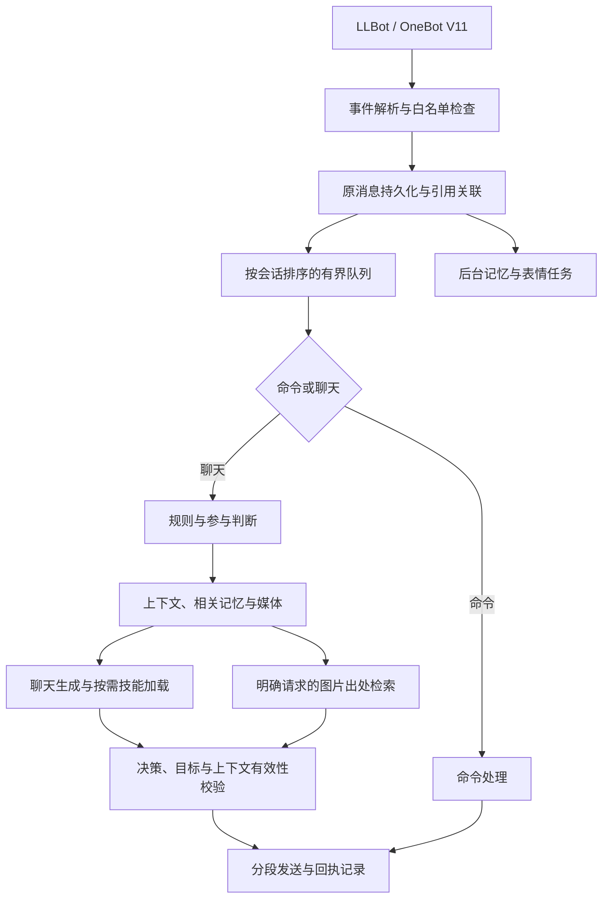

# 架构说明

[文档首页](README.md) · [配置说明](configuration.md) · [运维指南](../ops/OPERATIONS.md)

应用采用单进程 NoneBot + SQLite。LLBot 作为外部 QQ 接入服务，通过 OneBot V11 反向 WebSocket 传入事件；`persona_agent` 负责权限、对话、模型、记忆与媒体处理。

## 消息处理流程

每个会话按顺序处理。群聊每轮围绕一个原消息目标，私聊支持连续输入合并。普通群聊新消息不会取消已开始的回复；撤回、遗忘或会话重置使相关上下文失效时，会在生成与发送边界阻止旧内容继续使用。

普通参与先使用短文本判断，获准后才构建完整上下文、读取图片并调用聊天模型。明确呼叫跳过普通参与模型。图片出处检索直接使用接口结果构建回复，不由聊天模型补写出处。

## 模块导航

以下文件位于 [nonebot/src/plugins/persona_agent/](../nonebot/src/plugins/persona_agent/)：

| 模块 | 职责 |
| --- | --- |
| [plugin.py](../nonebot/src/plugins/persona_agent/plugin.py) | NoneBot 生命周期、消息与撤回事件、OneBot 收发 |
| [service.py](../nonebot/src/plugins/persona_agent/service.py) | 串联接收、排队、生成、纠正、发送和失败提示 |
| [conversation.py](../nonebot/src/plugins/persona_agent/conversation.py) | 事件结构、会话队列、批次等待与容量限制 |
| [participation.py](../nonebot/src/plugins/persona_agent/participation.py) | 群聊规则、轻量参与判断和续聊状态 |
| [context.py](../nonebot/src/plugins/persona_agent/context.py)、[prompt.py](../nonebot/src/plugins/persona_agent/prompt.py) | 上下文选择、预算与提示构建 |
| [references.py](../nonebot/src/plugins/persona_agent/references.py)、[forward.py](../nonebot/src/plugins/persona_agent/forward.py) | 引用链、补图关联与合并转发展开 |
| [gateway.py](../nonebot/src/plugins/persona_agent/gateway.py)、[model.py](../nonebot/src/plugins/persona_agent/model.py)、[scheduling.py](../nonebot/src/plugins/persona_agent/scheduling.py) | 模型快照、HTTP 调用、预算、并发与重试 |
| [decisions.py](../nonebot/src/plugins/persona_agent/decisions.py)、[delivery.py](../nonebot/src/plugins/persona_agent/delivery.py) | 结构化决策解析、目标校验与发送记录 |
| [commands.py](../nonebot/src/plugins/persona_agent/commands.py)、[skills.py](../nonebot/src/plugins/persona_agent/skills.py) | 管理命令与说明型技能加载 |
| [memory.py](../nonebot/src/plugins/persona_agent/memory.py)、[embedding.py](../nonebot/src/plugins/persona_agent/embedding.py) | 记忆整理、召回、纠正与 CPU 向量计算 |
| [vision.py](../nonebot/src/plugins/persona_agent/vision.py)、[images.py](../nonebot/src/plugins/persona_agent/images.py)、[image_sources.py](../nonebot/src/plugins/persona_agent/image_sources.py) | 媒体解析、图片读取和来源检索 |
| [stickers.py](../nonebot/src/plugins/persona_agent/stickers.py) | 表情同步、入库、候选选择与复核 |
| [storage.py](../nonebot/src/plugins/persona_agent/storage.py)、[store.py](../nonebot/src/plugins/persona_agent/store.py) | 数据库工作线程、schema 与基础存储 |
| [memory_store.py](../nonebot/src/plugins/persona_agent/memory_store.py)、[media_store.py](../nonebot/src/plugins/persona_agent/media_store.py)、[runtime_store.py](../nonebot/src/plugins/persona_agent/runtime_store.py) | 记忆、媒体与模型/发送状态的持久化 |

应用启动入口为 [nonebot/bot.py](../nonebot/bot.py)，本机与 systemd 通过 [ops/start_nonebot.py](../ops/start_nonebot.py)进入同一流程。

## 模型调度与失败处理

所有模型任务共用并发与用户用量预算。优先级依次为明确呼叫、普通参与、表情分析/主动私聊、记忆、表情复核；同优先级按进入顺序处理。最多同时运行一个后台模型请求，已经发出的请求不抢占。

每轮获得所选模型配置与凭据的快照。图片准备和后续生成使用同一快照；管理员切换模型只影响之后的请求。HTTP 客户端复用连接，不再使用的客户端在已有请求结束后释放。

| 期限 | 配置 |
| --- | --- |
| 单次模型 HTTP 等待上限 | `model.timeout_seconds`，模板为 123 秒 |
| 聊天流程共用期限 | `scheduler.chat_timeout_seconds`，模板为 123 秒 |
| 参与、媒体、记忆任务期限 | `model_tasks.<用途>.timeout_seconds`，模板为 123 秒 |
| 单图下载等待 | `model.image_timeout_seconds`，模板为 15 秒 |
| QQ 发送期限 | `scheduler.send_timeout_seconds`，模板为 20 秒 |

每次模型 HTTP 等待取模型上限与任务剩余期限的较小值，排队和重试不会重新获得完整期限。技能扩展、格式纠正及其他聊天重试共用聊天流程的剩余时间；图片读取和 QQ 发送还各有独立限制。

调用次数需要区分以下层次：

- **正常技能流程**：直接生成，或先选技能再生成，最多两轮。
- **决策纠正**：JSON 结构或技能激活不合法时，共享一次纠正机会；错误回复目标仍会被拒绝。
- **供应商拦截文本**：当前流程对识别到的拦截文本最多再试 3 次。
- **HTTP 重试**：连接建立失败或 HTTP 429/502/503/504 最多再试一次；读取或总期限超时不自动重试。

因此，两轮技能流程不等于最多两次实际 HTTP 请求。401/403 会暂停相同配置和凭据的调用，更新凭据或重启后恢复。失败结果区分排队超时、请求超时、上游超时、连接/鉴权错误、预算不足和响应结构错误。

## 发送与恢复

回复发送前校验 `target_message_id`、分段内容、表情候选及上下文版本。群聊首段使用原生引用，后续段自然续发，数据库中仍关联同一目标。

`reply_turns` 与 `reply_parts` 分别记录一轮和各段状态。中途失败停止剩余段，不重发整轮；发送超时或发送中进程退出标记为 `unknown`，重启不会自动补发。冷却与参与次数只按实际发出过正文的一轮更新。

失败提示属于控制消息，按机器人、会话和源消息去重，不进入普通上下文与记忆。具体触发范围见[使用指南](usage.md#排队与失败提示)。

## 存储与生命周期

数据库操作作为完整任务提交给单个专用线程，事务不跨协程交错，不在事件循环中同步执行。向量加载与推理使用独立线程，SQLite 保存向量和记忆来源；没有额外向量服务。

当前 schema 为 5，打开数据库时创建或补齐结构，包含参与者、记忆变更类型与本地向量表。迁移还处理消息媒体、撤回字段和 trigram 全文索引，不自动导入早期人物档案。当前遗忘账本必须存在并可重放，恢复细节见[运维指南](../ops/OPERATIONS.md#恢复流程)。

后台记忆、媒体入库和复核任务保存必要进度。应用每 30 分钟清理到期数据库记录；文件、隔离素材、日志和备份由 Linux 维护任务按保留规则处理。

停机时先停止接收，结束后台任务，等待消息队列最多 `shutdown_grace_seconds`，模板为 65 秒；systemd 模板提供 90 秒停止窗口。运行数据归属和备份范围见[目录职责](../ops/OPERATIONS.md#目录职责)。

## 排查入口

使用 `request_id` 串联原消息、参与判断、上下文、模型请求和发送结果；`raw_id`、`source_message_id` 与图片键帮助定位具体来源。`model_calls` 保存实际模型尝试，`reply_turns/reply_parts` 保存回执。

日志和用量只反映各阶段已记录的结果：缺少供应商用量时标记 `estimated`，失败占位的 0 token 不能证明没有消耗；`unknown` 也不能视作未发送。日志具体字段与共享前的处理见[日志与诊断](../ops/OPERATIONS.md#日志与诊断)。
